*This project has been created as part of the 42 curriculum by pablgarc, jonnavar, gsoteldo, jorexpos, jdiaz-he.*

# TaskFlow

## Table of Contents

- Description
- Instructions
- Resources
- Team Information
- Project Management
- Technical Stack
- Database
- Features List
- Modules
- Individual Contributions

## Tree


```text
.
├── docker-compose.yml
├── Dockerfile.backend
├── Dockerfile.frontend
├── document
│   ├── md
│   ├── pdf
│   └── png
├── package.json
├── package-lock.json
├── prisma
│   ├── migrations
│   └── schema.prisma
├── src
│   ├── app.ts
│   ├── config
│   ├── db
│   ├── modules
│   │   ├── auth
│   │   ├── authorization
│   │   ├── boards
│   │   ├── cards
│   │   ├── lists
│   │   ├── organizations
│   │   ├── sessions
│   │   ├── two_factor
│   │   └── users
│   ├── server.ts
│   └── shared
│       ├── crypto
│       ├── errors
│       └── http
├── frontend/                 # app Next.js
│   ├── app/
│   ├── components/
│   ├── lib/
│   ├── types/
│   ├── next.config.ts
│   ├── package.json
│   ├── README.md
│   └── FRONTEND_DOCS.md
└── tsconfig.json
```

## Description

**TODO:** Clearly presents the project, including its goal and a brief overview.

**TODO:** Should also contain a clear name for the project and its key features.

TaskFlow is a work-management web application inspired by Trello.

The implemented domain follows this hierarchy:

```text
Organization -> Board -> List -> Card
```

Users can authenticate, enable two-factor authentication, create shared organizations and boards, organize work into ordered lists, and create, edit, move, or archive cards.

## Instructions

The whole stack (PostgreSQL, Fastify backend and Next.js frontend) runs with Docker Compose. No Node.js or PostgreSQL installation is needed on the host.

```text
Browser --HTTPS:443--> nextjs (Next.js + TLS) --HTTP--> fastify (API) --TCP--> postgres
```

Only the `nextjs` container publishes a port (`443`). `fastify` and `postgres` are reachable only inside the Compose network, so every browser request goes through HTTPS.

### Prerequisites

- Docker Engine with the Compose plugin (`docker compose version` must work).
- OpenSSL, only to generate the TOTP key below.
- Port `443` free on the host.

### Quick start

1. Create your environment file from the example:

   ```bash
   cp .env.example .env
   ```

2. Replace `TOTP_ENCRYPTION_KEY_BASE64` in `.env` with a real key (32 random bytes, Base64):

   ```bash
   openssl rand -base64 32
   ```

3. Build and start everything:

   ```bash
   docker compose up --build
   ```

   Startup order is enforced by healthchecks: `postgres` becomes healthy, then `fastify` applies the Prisma migrations (`prisma migrate deploy`) and becomes healthy, then `nextjs` starts.

   PostgreSQL uses `pg_isready`. Fastify's `/health` runs `SELECT 1` via Prisma and returns HTTP 503 when the database is unavailable. Next.js checks its own HTTPS homepage using `curl --insecure` because the local certificate is self-signed. Compose reports these checks with `docker compose ps`; an unhealthy status does not itself restart a container. The dependency checks control initial startup, not recovery after a later outage.

4. Open the application:

   ```text
   https://localhost/
   ```

   The certificate is self-signed, so the browser shows a security warning the first time. Accept it, or trust the certificate as described below.

### Stopping and resetting

| Command | Effect |
| --- | --- |
| `docker compose down` | Stops and removes the containers; database data is kept |
| `docker compose down -v` | Also deletes the `postgres_data` volume (empty database on next start) |
| `docker compose ps` | Shows each service and its health |
| `docker compose logs -f fastify` | Follows the logs of one service |

### Environment variables used by Compose

Compose reads `${VAR}` values from the root `.env` file.

| Variable | Used by | Notes |
| --- | --- | --- |
| `POSTGRES_DB`, `POSTGRES_USER`, `POSTGRES_PASSWORD` | postgres, fastify | Database credentials; `fastify` builds its `DATABASE_URL` from them, pointing to the `postgres` service |
| `TOTP_ENCRYPTION_KEY_BASE64` | fastify | Required; 32 random bytes in Base64 |
| `SESSION_COOKIE_NAME`, `SESSION_TTL_DAYS`, `TOTP_ISSUER` | fastify | Optional; defaults `sid`, `14`, `Transcendence` |

Fixed values are set by the images or by `docker-compose.yml`: `NODE_ENV=production`, `HOST=0.0.0.0`, `PORT=3000`, `COOKIE_SECURE=true`, `INTERNAL_API_URL=http://fastify:3000` (build-time and runtime, used by the Next.js rewrites), `HTTPS_CERT_PATH` and `HTTPS_KEY_PATH`.

#### Configuration by container

The root `.env.example` is the single template. Copy it to `.env`, replace the example PostgreSQL password with a local password containing URL-safe characters, and generate a TOTP encryption key. The sample credentials are for local development only. Compose interpolates the root `.env`; it does not pass every value from that file into every container.

**PostgreSQL (runtime):** `POSTGRES_DB` and `POSTGRES_USER` default to `transcendence` and `postgres`; `POSTGRES_PASSWORD` is required. Compose also uses these values to construct the backend connection URL.

**Fastify (runtime):** `NODE_ENV` is `production` in Docker (`development`, `test`, or `production` elsewhere); `HOST` and `PORT` are `0.0.0.0` and `3000` in Docker. `DATABASE_URL` is a PostgreSQL URL required outside test: Compose constructs it for the container, while the template's value is for running the backend on the host. `TOTP_ENCRYPTION_KEY_BASE64` must decode to 32 random bytes and is required outside test; tests use a fixed non-secret key if omitted. `COOKIE_SECURE` is `true` in Compose and accepts `true` or `false`; `SESSION_COOKIE_NAME` defaults to `sid`, `SESSION_TTL_DAYS` to `14` positive whole days, and `TOTP_ISSUER` to `Transcendence`.

**Next.js (build and runtime):** `INTERNAL_API_URL` is the server-side backend URL, set to `http://fastify:3000` by Compose both at build time and runtime. Rewrites are generated at build time, so changing only its runtime value does not update them: rebuild the image when changing it. At runtime `HOST` and `PORT` default to `0.0.0.0` and `3000`; `HTTPS_CERT_PATH` and `HTTPS_KEY_PATH` point to the generated certificate and private key. `server.mjs` requires those paths and `INTERNAL_API_URL` and exits if they are missing. The image sets `NODE_ENV=production` and `NEXT_TELEMETRY_DISABLED=1`; Compose also passes `COOKIE_SECURE=true`, although the current frontend code does not use it.

No application `NEXT_PUBLIC_*` variables are currently used or deliberately exposed to the browser. If introduced, their values are public and Next.js embeds them during the frontend build: pass them as Docker build arguments and rebuild the image. Setting them only when the container starts will not update the client bundle. Never put secrets in them.

### HTTPS and the self-signed certificate

- `frontend/server.mjs` is a small Node.js HTTPS server that wraps Next.js, because `next start` cannot serve HTTPS.
- `frontend/scripts/generate-cert.sh` creates the certificate with OpenSSL while the image is built (valid for `localhost` and `127.0.0.1`, 365 days). It is never committed.
- `frontend/next.config.ts` proxies `/api/*` requests to Fastify, removing the `/api` prefix, so the browser only talks to `https://localhost`.

#### How to trust the certificate locally

The warning is expected and safe to accept for local evaluation. To remove it, export the certificate and add it as a trusted authority:

```bash
docker compose cp nextjs:/app/certs/cert.pem ./localhost-cert.pem
```

- **Windows:** double-click `localhost-cert.pem` (rename it to `.crt` if needed), choose *Install Certificate*, *Local Machine*, and place it in *Trusted Root Certification Authorities*.
- **macOS:** open it with *Keychain Access*, add it to the *System* keychain and set *Always Trust*.
- **Linux (Chrome):** `chrome://settings/certificates`, *Authorities*, *Import*.
- **Firefox (any OS):** *Settings*, *Privacy & Security*, *View Certificates*, *Authorities*, *Import*.

A new certificate is generated every time the `nextjs` image is rebuilt, so import it again after a rebuild. Delete `localhost-cert.pem` afterwards; it is ignored by Git.

### Backend development without Docker (optional)

PostgreSQL is not published on the host, so to run the backend with npm publish it temporarily:

```bash
docker compose run --rm -d -p 127.0.0.1:5432:5432 --name transcendence-db postgres
npm install
npm run prisma:migrate:deploy
npm run build
npm start                      # http://127.0.0.1:3000/
docker stop transcendence-db   # when finished
```

This uses the local values of `.env` (`HOST=127.0.0.1`, `DATABASE_URL` pointing to `127.0.0.1`).

### Available scripts

| Command | Purpose |
| --- | --- |
| `npm run dev` | Compile TypeScript continuously in watch mode |
| `npm run build` | Generate Prisma Client and compile `src/` into `dist/` |
| `npm start` | Start `dist/server.js` |
| `npm run prisma:generate` | Regenerate Prisma Client |
| `npm run prisma:migrate:dev` | Create and apply a migration during development |
| `npm run prisma:migrate:deploy` | Apply pending migrations in staging or production |
| `npm run prisma:migrate:status` | Show migration status |
| `npm run prisma:format` | Format `prisma/schema.prisma` |
| `npm run prisma:validate` | Validate the Prisma schema |

## Resources

**TODO:** Lists classic references related to the topic (documentation, articles, tutorials, etc.).

Primary technical references:

- [Fastify documentation](https://fastify.dev/docs/latest/)
- [Prisma documentation](https://www.prisma.io/docs)
- [PostgreSQL documentation](https://www.postgresql.org/docs/)
- [Zod documentation](https://zod.dev/)
- [Node.js Crypto documentation](https://nodejs.org/api/crypto.html)
- [OWASP Authentication Cheat Sheet](https://cheatsheetseries.owasp.org/cheatsheets/Authentication_Cheat_Sheet.html)
- [WCAG 2.1](https://www.w3.org/TR/WCAG21/)

### AI usage

AI was not used for any task or any part of the project.

## Team Information

**TODO:** For each team member mentioned at the top of the README.md, provide:

- Assigned role(s): Product Owner, Project Manager/Scrum Master, Technical Lead, and Developer.
- Brief description of their responsibilities.

## Project Management

**TODO:** How the team organized the work (task distribution, meetings, etc.).

**TODO:** Tools used for project management (GitHub Issues, Trello, etc.).

**TODO:** Communication channels used (Discord, Slack, etc.).

## Technical Stack

**TODO:** Frontend technologies and frameworks used.

**TODO:** Backend technologies and frameworks used.

**TODO:** Database system and why it was chosen.

**TODO:** Any other significant technologies or libraries.

**TODO:** Justification for major technical choices.

| Area | Technology | Reason for use |
| --- | --- | --- |
| Runtime | Node.js with ESM | Modern JavaScript runtime and native cryptographic APIs |
| Language | TypeScript 5.9, strict mode | Static checks across routes, services, and repositories |
| Backend framework | Fastify 5 | Routing, lifecycle hooks, plugins, and request injection |
| Frontend framework | Next.js 16 | File-based routing, multiple rendering per-page, image optimization, font optimization, code splitting |
| Validation | Zod 4 and `fastify-type-provider-zod` | Runtime validation with inferred request types |
| Database | PostgreSQL 16 | Relational integrity, transactions, and concurrency controls |
| ORM | Prisma 6 | Typed database access and schema relationships |
| Test doubles | In-memory repositories | Fast tests without a database; never used outside `NODE_ENV=test` |
| Authentication | Cookies, `scrypt`, TOTP | Stateful sessions and optional second-factor protection |
| Local infrastructure | Docker Compose | Reproducible PostgreSQL service for development |
| Manual UI | HTML, CSS, and browser JavaScript | Development-only API testing without a separate client build |

## Database

### Database Schema

The schema is defined in [`prisma/schema.prisma`](./prisma/schema.prisma). A generated Entity-Relationship Diagram (ERD) is available at [`document/ERD.svg`](./document/ERD.svg) and is regenerated automatically every time "prisma generate" runs.



### Domain model

The application is built around a five-level hierarchy:

```text
User → Organization → Board → List → Card
```

- User: A user can belong to multiple organizations and be assigned to cards across boards.
- Organization: The top-level container for shared work. Each organization has its own membership list and its own set of boards. A user's role inside an organization determines what they can do within it.
- Board: A workspace inside an organization. It contains ordered lists and its own set of labels. Boards are the primary unit users open to view and manipulate work.
- List: An ordered column inside a board. Lists hold cards and enforce a unique constraint (board_id, position) so that ordering is stable.
- Card: The atomic unit of work. A card belongs to a list and carries a title, description, optional due date, assignees, labels, and comments.

Secondary entities hang off the hierarchy:
- Comment: Attached to a card, authored by a user.
- Label: Scoped to a board, assignable to many cards through the "card_labels" join table.
- CardAssignee: The many-to-many link between users and cards.
- OrganizationMember / BoardMember: Explicit membership tables that carry a role and a join timestamp.

Authentication entities (PasswordCredential, Session, LoginChallenge, TwoFactorTotp, RecoveryCode) are isolated from the domain hierarchy and are only referenced by the User model.

### Roles

Roles are scoped at three levels, which allows a user to have different permissions in different contexts:

| Level | Model | Example roles | Controls |
| --- | --- | --- | --- |
| Application | "User.role" | "user", "moderator", "admin" | Application roles define how much authority users have over the platform as a whole, independent of any organization |
| Organization | "OrganizationMember.role" | "owner", "admin", "member" | Organization roles define how much authority users have over one organization: Its members, its boards, its settings, and its lifecycle |
| Board | "BoardMember.role" | "admin", "member", "observer" | Board roles define how much authority users have over one board and its contents, including lists, cards, comments, and board-level membership |

### Deletion strategies

The schema uses two deletion strategies, chosen based on the entity's role in the domain:

- Soft deletes: "Board.archivedAt", "BoardList.archivedAt", "Card.archivedAt", "Organization.archivedAt", "Comment.deletedAt". These entities retain their row in the database, allowing recovery, audit trails, and referential integrity with historical data. Application queries filter on "archivedAt IS NULL" or "deletedAt IS NULL" by default.
- Hard deletes (cascade): When an Organization is physically deleted, its Boards are deleted ("onDelete: Cascade"), and so on down the hierarchy. Membership rows ("OrganizationMember", "BoardMember"), join rows ("CardAssignee", "CardLabel"), and dependent entities ("Comment", "BoardList", "Card") also cascade. This ensures that removing a parent does not leave orphaned rows.

### Composite primary keys

Four junction tables use composite primary keys instead of a surrogate "id" column. This enforces uniqueness at the database level and prevents duplicate relationships:

| Table | Composite key | Purpose |
| --- | --- | --- |
| "organization_members" | "(organization_id, user_id)" | A user can join an organization only once |
| "board_members" | "(board_id, user_id)" | A user can join a board only once |
| "card_assignees" | "(card_id, user_id)" | A user can be assigned to a card only once |
| "card_labels" | "(card_id, label_id)" | A label can be applied to a card only once |

Because the primary key is the natural composite, no additional unique index is required, and the database enforces the invariant without application-level checks.

### Database Migrations

Prisma Migrate is the only migration system used by the project, migration history is stored in `prisma/migrations`.

The initial migration contains the current schema:

1. `prisma/migrations/20260920120000_init/migration.sql`: users, credentials, sessions, 2FA, organizations, boards, lists, cards, board members, assignees, comments, and labels.

### Add a Migration

First, edit “prisma/schema.prisma” to add or modify a model in the schema file.

Then, run the following command:

```bash
prisma migrate dev --name <migration_name>
```

- The command detects drifts, checking if the database schema is out of sync with the migration history.
- It compares the new “schema.prisma” with the previous migration state and generates a new SQL migration file in “prisma/migrations/TIMESTAMP_name/migration.sql”.
- It runs the SQL file against the development database in the postgres container.
- It runs “prisma generate” automatically, regenerating the TypeScript client and updating its types.

Review the generated “migration.sql” file, check that Prisma didn’t do anything unexpected.

Finally, commit both the updated “schema.prisma” and the new migration directory to Git.

### Migration lock

The "migration_lock.toml" exists to lock the database provider for the migration history.
Its primary purpose is to prevent accidentally applying a set of migrations that were generated for one database type to a completely different database type.

```bash
find ./ -name "migration_lock.toml"
```

Prisma Migrate generates raw SQL files that are specific to the database provider being used.
The SQL syntax differs for different database providers.

If the provider is changed in the schema.prisma but the old migration files are kept, Prisma will fail attempting to run SQL files whose syntax does not match the database provider.

### Raw queries

All database access in this project goes through the Prisma Client API (`prisma.model.operation()`) with full type safety.
The exceptions are documented here.

```bash
# list all raw queries
grep -rn '\$queryRaw\|\$executeRaw\|\$queryRawUnsafe\|\$executeRawUnsafe' ./src
```

**File:** `src/modules/cards/cards.prismaRepository.ts`
**Functions:** `create()`, `move()`

**Why:** The `cards` table has a uniqueness constraint on `(list_id, position)`.
When two users create or move cards in the same list concurrently, both transactions would compute the same next position and one would fail with `P2002`.
To prevent this, we acquire a PostgreSQL transaction-scoped advisory lock keyed by the target list ID before computing the next position.
This serializes position computation per list, while allowing unrelated lists to proceed in parallel.

**Why not a Prisma query API:** Prisma has no API for advisory locks. 
They are a PostgreSQL-specific concurrency primitive. 
The alternative would be an application-level mutex (which wouldn't protect across multiple backend instances) or dropping the unique constraint (which would weaken data integrity).

**Safety:** The query uses Prisma's tagged-template `$queryRaw`, which parameterizes `${...}` values as SQL bind parameters (`$1`, `$2`, ...).
No string interpolation occurs. 
The lock is scoped to the enclosing transaction and released automatically on commit or rollback.

**Additional safety:** A retry wrapper (`withPositionRetry`) retries up to three times on `P2002` (unique constraint) and `P2034` (deadlock / serialization failure) errors, providing defense in depth against transient contention.

**File:** `src/modules/lists/lists.prismaRepository.ts`
**Functions:** `create()`, `reorder()`

**Why:** The create() and reorder() methods in lists.prismaRepository.ts use raw queries for the exact same purpose as the create() and move() methods in cards.prismaRepository.ts.
They prevent race conditions when calculating the next available integer for an ordered list, while working around PostgreSQL's @@unique constraint.

### In-memory repositories

The project uses the **repository pattern**: every data-access concern is expressed as an interface (e.g., `UsersRepository`, `BoardsRepository`), with two implementations.

| Implementation | Location | Purpose |
| --- | --- | --- |
| `Prisma*Repository` | `src/modules/*/<module>.prismaRepository.ts` | Production implementation, backed by Prisma Client |
| `InMemory*Repository` | `src/modules/*/<module>.repository.ts` | Test-only implementation, backed by `Map` and `Set` |

In-memory repositories exist solely to support unit tests without a database. They are never used in development, production, or the Docker deployment.

This invariant is enforced by two independent guards, so a misconfigured deployment fails loudly instead of silently degrading:

1. Configuration guard: Uses Zod's "superRefine" to require "DATABASE_URL" whenever "NODE_ENV" is "development" or "production". The application refuses to start if the variable is missing outside "NODE_ENV=test".
2. Composition guard: Selects the repository implementation based on "NODE_ENV". In any environment other than "test", it throws at startup if "createPrismaClient()" returned "null".

A misconfigured production container therefore exits immediately rather than serving requests against an empty in-memory store.

## Features List

### Roles and user administration

| Scope | Roles | Meaning |
| --- | --- | --- |
| Global | `user`, `moderator`, `admin` | Moderators and admins can read users; admins can manage them. |
| Organization | `member`, `admin`, `owner` | Membership roles used by organization operations. |
| Board | `observer`, `member`, `admin` | Observers have read-only access; members and admins have broader board permissions. |

Roles are defined in `src/modules/authorization/roles.ts` and constrained by Prisma enums. The role migration preserves existing values and fails on unknown values; inspect and correct any such records before applying it. Global roles apply to user administration; organization and board membership roles apply to their respective resources. A global administrator does not automatically become an organization or board administrator.

The tables below describe the current **backend API**, not frontend visibility. All listed operations require an authenticated session. A missing or invalid session returns `401`; insufficient roles normally return `403` with a machine-readable error code. Missing, archived, or inaccessible organizations and boards can return `404` rather than disclose their existence. For browser requests, prefix the paths below with `/api`.

#### Global roles

| Action | `user` | `moderator` | `admin` |
| --- | --- | --- | --- |
| Read own account (`GET /me`) | Yes | Yes | Yes |
| List and read other users | No | Yes | Yes |
| Edit or soft-delete other users | No | No | Yes |
| Use the legacy `GET /admin/users` endpoint | No | No | Yes |

| Endpoint | Required global role | Purpose |
| --- | --- | --- |
| `GET /users` | moderator or admin | List users with `limit`, `offset`, optional `role` and `status` filters; deleted users are excluded by default. |
| `GET /users/:id` | moderator or admin | Read a user's public account fields. |
| `PATCH /users/:id` | admin | Update display name, email, role, or active/disabled status. |
| `DELETE /users/:id` | admin | Soft-delete another user, preserving related records. |
| `GET /admin/users` | admin | Existing legacy listing endpoint. |

Administrators cannot change their own role, disable their own account, or delete themselves. A database transaction serializes changes that could remove the last active administrator. Disabled and deleted accounts cannot authenticate. User responses do not contain password hashes, TOTP secrets or recovery codes.

#### Organization roles

Any authenticated user can create an organization and becomes its `owner`. The following permissions apply within an organization to which the user belongs:

| Action | `member` | `admin` | `owner` |
| --- | --- | --- | --- |
| Read the organization and list its boards | Yes | Yes | Yes |
| Update organization settings | No | Yes | Yes |
| Create a board | No | Yes | Yes |
| Add an active user as `member` | No | Yes | Yes |
| Add an active user as `admin` | No | No | Yes |
| Change an existing member's role | No | No | Yes, except an `owner` role |
| Remove a `member` | No | Yes | Yes |
| Remove an `admin` | No | No | Yes |
| Remove an `owner` or change their role | No | No | No |
| Archive the organization | No | No | Yes |

`PUT /organizations/:organizationId/members/:userId` adds a user or sets their role; its body contains `role: "member"` or `role: "admin"`. An organization admin may repeat an unchanged `member` assignment, but cannot assign an admin role or change an existing role. `DELETE /organizations/:organizationId/members/:userId` removes a membership and its board memberships in that organization. `DELETE /organizations/:organizationId` archives the organization. These are soft archives of the organization itself; membership removal deletes the relevant membership records.

#### Board roles

The user must belong to the board's organization. Organization `owner` and `admin` roles grant implicit board administration. An organization `member` without an explicit board membership can read the board but has no write access; an explicit `observer` is also read-only. An explicit board `member` can write, and an explicit board `admin` can manage the board.

| Action | Org member without board membership or board `observer` | Board `member` | Board `admin` | Org `admin` | Org `owner` |
| --- | --- | --- | --- | --- | --- |
| Read board, lists, cards and comments | Yes | Yes | Yes | Yes | Yes |
| Create or edit lists, cards and comments; archive cards | No | Yes | Yes | Yes | Yes |
| Edit board settings | No | No | Yes | Yes | Yes |
| Add, change or remove board members | No | No | Yes | Yes | Yes |
| Archive board | No | No | Yes | Only with explicit board `admin` membership | Yes |

Board members being added must already belong to the organization. The current API lets a board administrator assign any of the three board roles and remove board memberships; organization owners and admins retain their implicit access even if an explicit board membership is removed. A member with write access may edit or soft-delete any comment on an accessible card, regardless of its author.

| Endpoint | Required scope |
| --- | --- |
| `GET /organizations/:organizationId/boards` | Organization member |
| `POST /organizations/:organizationId/boards` | Organization admin or owner |
| `GET /boards/:boardId` | Organization member |
| `PATCH /boards/:boardId` | Board admin, organization admin or owner |
| `PUT /boards/:boardId/members/:userId` | Board admin, organization admin or owner; body `role` is `observer`, `member` or `admin` |
| `DELETE /boards/:boardId/members/:userId` | Board admin, organization admin or owner |
| `DELETE /boards/:boardId` | Explicit board admin or organization owner; archives the board |
| `GET /boards/:boardId/lists`, `GET /lists/:listId/cards`, `GET /cards/:cardId`, `GET /cards/:cardId/comments` | Organization member with read access |
| `POST /boards/:boardId/lists`, `PATCH /lists/:listId`, `POST /boards/:boardId/lists/reorder` | Board member or admin, organization admin or owner |
| `POST /lists/:listId/cards`, `PATCH /cards/:cardId`, `POST /cards/:cardId/move`, `DELETE /cards/:cardId` | Board member or admin, organization admin or owner; moving a card requires write access to both lists |
| `POST /cards/:cardId/comments`, `PATCH /cards/:cardId/comments/:commentId`, `DELETE /cards/:cardId/comments/:commentId` | Board member or admin, organization admin or owner |

Scoped route guards are implemented in `src/modules/authorization/requireScopeRole.ts`; organization, board, list, card and comment services also check the applicable permissions. User-administration routes use `requireRole` and the user service. Global user mutations use an advisory transaction lock to protect the last active administrator. These backend checks remain authoritative even when a future frontend hides actions.

Administrative accounts need to be provisioned securely by the team; the demo seed is a separate backlog story. The integration tests currently remain local and are not included in the repository.

**TODO:** Complete list of implemented features.

**TODO:** Which team member(s) worked on each feature.

**TODO:** Brief description of each feature’s functionality.

## Modules

**TODO:** List of all chosen modules (Major and Minor).

**TODO:** Point calculation (Major = 2pts, Minor = 1pt).

**TODO:** Justification for each module choice, especially for custom "Modules of choice".

**TODO:** How each module was implemented.

**TODO:** Which team member(s) worked on each module.

## Individual Contributions

**TODO:** Detailed breakdown of what each team member contributed.

**TODO:** Specific features, modules, or components implemented by each person.

**TODO:** Any challenges faced and how they were overcome.

